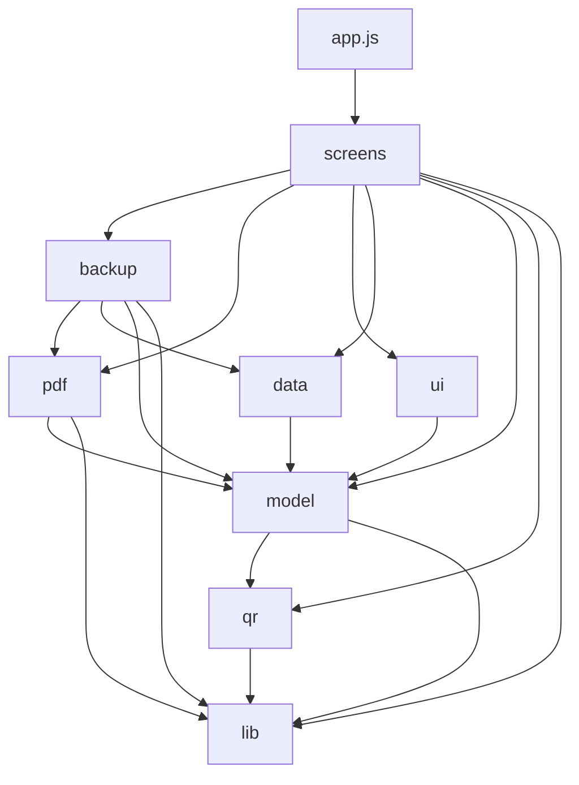
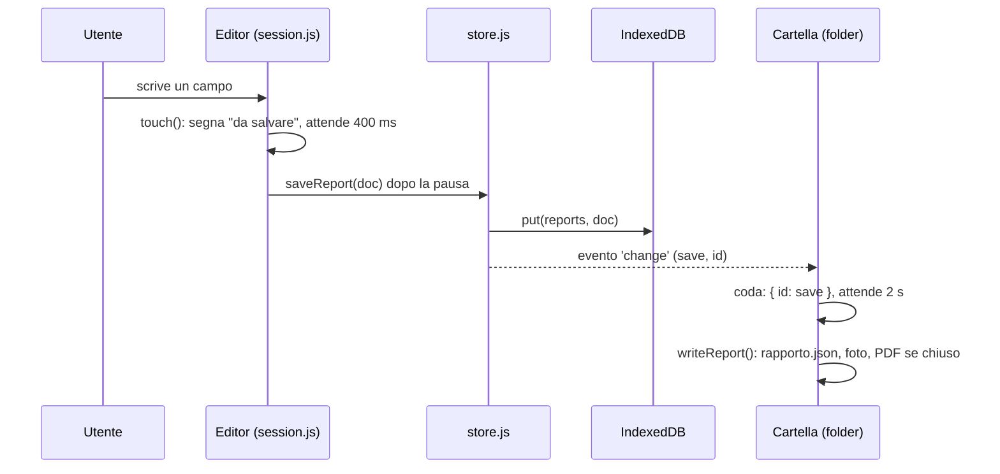

# Architettura

Fiamma è una **PWA statica**: pagine e script serviti così come sono, senza server, senza compilazione e senza `npm`. Tutto quello che l'app sa sta sul telefono (IndexedDB e `localStorage`) e, se l'utente lo vuole, in una cartella di copia.

## Le scelte, in breve

| Scelta | Perché |
|---|---|
| Nessun server | I dati dei clienti restano sul telefono; l'app funziona anche senza rete (service worker). |
| Nessuna compilazione | Si modifica un file e si ricarica; il sito si pubblica da `main` su GitHub Pages così com'è. |
| Moduli ES nativi | `import` e `export` diretti nel browser; le stesse funzioni si provano anche con Node. |
| Tailwind CSS 4 "browser" | Stile con classi utility senza una fase di build; il tema sta in `css/tailwind.css` (vedi [Interfaccia](07-interfaccia.md)). |
| IndexedDB | Rapporti e foto (anche molti megabyte) non entrano in `localStorage`. |
| Librerie in `vendor/` | pdf-lib, fontkit, zxing-wasm, Tailwind e i font sono inclusi nel repository: nessuna rete per usarle. |
| Il dato è il rapporto | Un rapporto è un solo oggetto JSON (`customer`, `plant`, `intervention`, `measures`…): niente anagrafiche, niente rubrica. |

## Cartelle del repository

```
index.html  manifest.json  sw.js      pagina, PWA e uso offline: devono stare in radice
css/        tema e componenti di Tailwind, e il caricamento di Tailwind
img/        icona (SVG) e PNG per il telefono
vendor/     librerie incluse, con le licenze
tools/      make-icons.cjs: ricava i PNG dall'icona SVG
tests/      unit/ (logica, con Node) e e2e/ (browser, con Playwright)
docs/       questa documentazione
src/        tutto il programma
```

## I livelli di `src/`

`src/` è diviso in cartelle che si appoggiano solo a quelle sotto di loro. La prova [`tests/unit/layers.test.mjs`](../../tests/unit/layers.test.mjs) lo controlla a ogni esecuzione, insieme al fatto che ogni importazione trovi il suo file.



| Cartella | Cosa contiene | Tocca il DOM o il database? |
|---|---|---|
| `lib/` | Date italiane, codice fiscale, posizione e indirizzo, ZIP | No (`geo.js` usa la posizione del browser) |
| `qr/` | Lettura del QR (`scanner.js`, usa la fotocamera) e decodifica dei dati Testo (`tjf/`, pura logica) | Solo `scanner.js` |
| `model/` | Rapporto, apparecchi, numerazione, elenco, misure, email | No: si prova con Node |
| `data/` | IndexedDB, rapporti, foto e logo, impostazioni, scansioni rapide | Database e `localStorage` |
| `pdf/` | Il PDF, una parte del foglio per file | No (usa pdf-lib, caricata a parte) |
| `backup/` | Backup in un file ZIP e copia nella cartella di salvataggio | Database, file del telefono |
| `ui/` | Navigazione, classi di stile, utilità per costruire la pagina | Sì |
| `screens/` | Una schermata per file (l'editor ha una cartella) | Sì |

`app.js` (livello più alto) si appoggia a `screens`, e per l'avvio anche a `ui`, `data` e `backup`. La regola che ne discende: **la logica non conosce lo schermo**. Un controllo come "il numero del rapporto" o "il confronto di due misure" sta in `model/` e si prova senza browser; la schermata si limita a chiamarlo e a mostrare il risultato.

## Come parte l'app

1. `index.html` nasconde la pagina (`<html hidden>`), carica `css/load-tailwind.js` (che legge `css/tailwind.css`, avvia Tailwind e mostra la pagina quando lo stile è pronto) e infine `src/app.js` come modulo.
2. `app.js` registra le classi di stile create dal JS (`registerClasses`), il service worker, e ogni schermata (`init()` una volta e `nav.register`).
3. `folder.start()` avvia, se serve, la copia nella cartella di salvataggio.
4. `nav.start()` mostra la home; poi `runShortcut()` esegue una scorciatoia dell'icona (`?azione=nuovo` o `?azione=scansione`) e ripulisce l'indirizzo.

## Il percorso di una modifica

Quando si scrive un campo nel rapporto, succede questo:



- L'editor non salva a ogni tasto: `touch()` fa partire un timer di 400 ms (`debounce`). All'uscita dalla schermata e quando la pagina va in secondo piano il salvataggio avviene subito (`flush`).
- Il salvataggio ha sempre un esito visibile ("Salvato 14:32", "Salvataggio…", "NON SALVATO · tocca per riprovare").
- `store.js` emette un evento `change` a ogni scrittura: chi ascolta (oggi solo `folder`) non ha bisogno di essere chiamato dagli altri moduli.

## Dove stanno i dati

| Cosa | Dove | Chiave |
|---|---|---|
| Rapporti, foto, logo, stato della cartella | IndexedDB `testoqr-reports` | stores `reports`, `photos`, `meta` |
| Impostazioni (ditta, email e suo testo, contatori) | `localStorage` | `testoqr.config` |
| Scansioni rapide (ultime 20) | `localStorage` | `testoqr.scans` |
| Copia di sicurezza | Cartella scelta dall'utente | `Fiamma/…` |
| File dell'app per l'uso offline | Cache del service worker | `fiamma-vN` |

I nomi interni cominciano per `testoqr` (il nome storico del progetto): sono invisibili e **non vanno cambiati**, perché cambiarli azzera i dati già salvati. Dettagli in [Modello dati](03-modello-dati.md) e [Archiviazione e copie](06-archiviazione-e-copie.md).

## Avanti

- [Struttura del codice](02-struttura-del-codice.md): file per file.
- [Guida allo sviluppo](10-guida-allo-sviluppo.md): come si lavora e come si fanno le modifiche più comuni.
