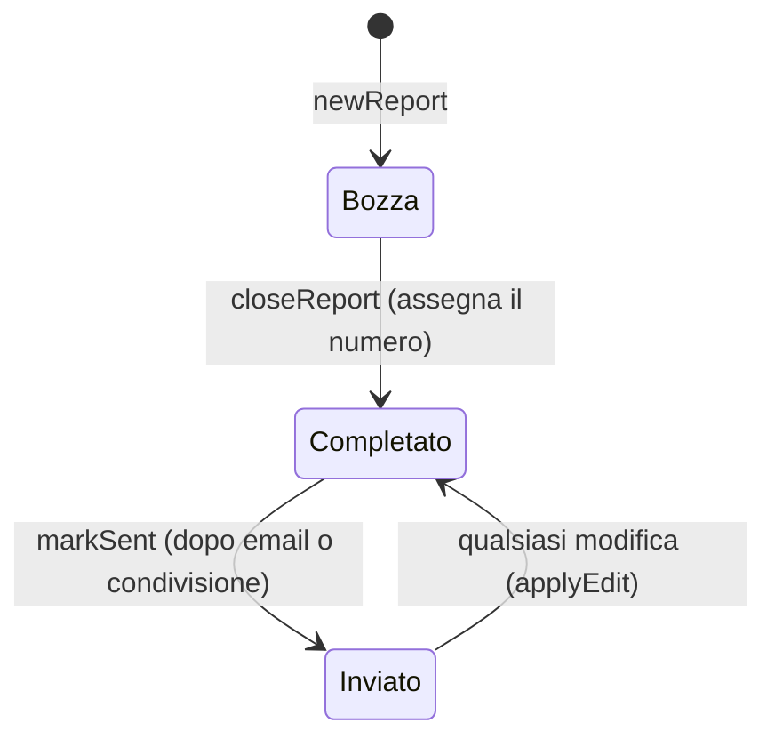

# Modello dati

Tutto il modello sta in `src/model/` ed è pura logica: nessun accesso al DOM né al database. Qui si descrive la forma dei dati, le regole e i formati dei file.

## Il rapporto

Un rapporto è un solo oggetto, salvato così com'è in IndexedDB (store `reports`, chiave `id`):

```js
{
  id,                 // identificativo, es. un UUID
  number,             // null finché è bozza; dopo la chiusura "2026/012"
  status,             // 'draft' | 'done' | 'sent'  (Bozza, Completato, Inviato)
  date,               // data dell'intervento, "2026-10-22"
  createdAt, updatedAt, closedAt, sentAt, deletedAt,   // millisecondi, o null
  customer:     { name, fiscalCode, address, phone },
  plant:        { plateCode, units: [ /* apparecchi */ ] },
  intervention: { type, outcome, work, materials: [{ text, qty }], startTime, endTime, notes },
  measures:     [{ id, label, json, addedAt }],        // json = il JSON TJF letto dal QR
  photoCount                                           // le foto stanno nello store `photos`
}
```

- `newReport()` (`src/model/report.js`) crea una **bozza vuota, senza apparecchi**: tutti i campi di testo sono stringhe vuote.
- `intervention.type` è uno di `INTERVENTION_TYPES` (`ordinaria`, `straordinaria`, `riparazione`, `accensione`, `efficienza`, `sopralluogo`, `altro`); `outcome` uno di `OUTCOMES` (`ok`, `anomalie`, `ko`). Una stringa vuota vuol dire "non indicato".
- Orari come `"09:10"`; `durationMinutes(inizio, fine)` calcola la durata anche oltre la mezzanotte.
- `photoCount` è solo un contatore per l'elenco; le foto vere si leggono con `listPhotos(reportId)`.

### Stati




- `closeReport` (solo da bozza): assegna il numero se manca, passa a `done`, imposta `closedAt`.
- `markSent` (solo da `done`/`sent`): passa a `sent`, imposta `sentAt`. Una bozza non diventa mai "inviata".
- `applyEdit` si chiama a ogni modifica fatta dall'utente: aggiorna `updatedAt` e, se il rapporto era `sent`, lo riporta a `done` (così in elenco si vede che va rimandato). Il cambio di stato fatto da `close`/`markSent` salva con `edit: false`, per non annullare se stesso.
- **Cestino** (a parte dagli stati): eliminare imposta `deletedAt` (e `updatedAt`); stato e numero non cambiano, e ripristinando il rapporto torna com'era. Un rapporto nel cestino non compare in elenco; dopo `TRASH_DAYS` (30) giorni `purgeExpired` lo toglie per sempre, con le foto. Una **bozza mai compilata** (`isBlank`) non passa dal cestino: si elimina subito.

### Bozza vuota (`isBlank`)

È vuota una bozza senza numero, misure e foto i cui campi (cliente, targa, apparecchi senza i loro id, intervento senza gli orari) sono uguali a quelli di `newReport`. La home le scarta da sola; l'editor le elimina senza cestino. Aggiungere un apparecchio, anche senza compilarlo, la rende "compilata".

### Numerazione

- I contatori stanno nelle impostazioni: `counters = { "2026": 11, "2025": 40 }` = ultimo numero **usato** per ogni anno.
- L'anno è quello della **data dell'intervento** (`reportYear`), non della chiusura.
- Alla chiusura: `nextNumber(counters, anno)` = ultimo + 1, e `formatReportNumber(2026, 12)` → `"2026/012"` (almeno tre cifre).
- Il numero si assegna una volta sola: un rapporto già chiuso non lo cambia, e un rapporto eliminato non lo libera (il contatore non torna indietro). L'utente può cambiare il prossimo numero dalle impostazioni (`setNextNumber`).

### Duplicare

`duplicateReport` crea una nuova bozza con **cliente e impianto** (gli apparecchi con identificativi nuovi): non copia misure, foto, lavori, materiali, note né orari. La data è quella di oggi.

### Nomi dei file

`reportFileName(doc)`: `Rapporto_2026-012_Mario-Rossi.pdf`, oppure per una bozza `Bozza_2026-10-22_Mario-Rossi.pdf`. `slug` toglie accenti e caratteri speciali (`Mario D'Èrrico` → `Mario-D-Errico`). `folderPath` (in `src/backup/folder/paths.js`) dà la cartella nella copia: `2026-012_Mario-Rossi_ab12cd34` (bozza: `BOZZA_2026-10-22_Mario-Rossi_ab12cd34`, dove `ab12cd34` sono le prime 8 lettere o cifre dell'`id`).

## Gli apparecchi

`plant.units` è un elenco di apparecchi di qualunque tipo e in qualunque numero:

```js
{ id, kind: 'caldaia' | 'pompa' | 'condizionatore', ...campi del tipo }
```

La definizione dei tipi è `UNIT_KINDS` in `src/model/units.js`: per ogni tipo, `label`, `plural`, `short` e `fields`. Ogni campo ha `key`, `label` e, secondo i casi, `options` (menu), `date`, `decimal` (si scrive con il tastierino numerico) e `unit` (kW, kg).

| Tipo | Campi (chiave) |
|---|---|
| Tutti | `brand`, `model`, `serial`, `installDate` |
| `caldaia` | `fuel` (metano, gpl, gasolio), `chamber` (aperta, forzata), `technology` (condensazione, tradizionale), `nominalPower`, `actualPower` (kW) |
| `pompa` | `hpType` (aria-acqua, aria-aria, acqua-acqua, geotermica), `nominalPower`, `coolingPower` (kW), `refrigerant`, `charge` (kg) |
| `condizionatore` | `acType` (monosplit, multisplit, canalizzato, cassetta, altro), `indoorUnits`, `coolingPower`, `nominalPower` (riscaldamento, kW), `refrigerant`, `charge` (kg) |

`refrigerant` ∈ `r32`, `r410a`, `r290`, `r134a`, `r407c`, `r454b`, `r744`, `altro`.

- `newUnit(kind, valori, id)` crea l'apparecchio con **solo** i campi del suo tipo (gli altri valori si ignorano).
- `unitTitle(unit, units)`: "Caldaia", e "Caldaia 1", "Caldaia 2" se ce n'è più di una dello stesso tipo. `unitsSummary`: `"1 caldaia, 2 condizionatori"`.
- `unitValues(unit)`: i campi pronti da mostrare (menu → etichetta, data → `gg/mm/aaaa`, kW e kg con l'unità), con la `key` di ciascuno.
- La ricerca nell'elenco trova marca, modello e matricola di **tutti** gli apparecchi (`searchText`).

Per aggiungere un campo o un tipo vedi [Guida allo sviluppo](10-guida-allo-sviluppo.md#un-nuovo-campo-o-un-nuovo-tipo-di-apparecchio).

## Dati letti da fuori: `normalizeReport`

Quello che arriva da una cartella o da un backup non si fida: `normalizeReport(raw)` (in `src/model/normalize.js`) rifà **un rapporto pulito** o restituisce `null` se non è un rapporto.

- `id` deve essere valido (`isId`: lettere, cifre, `_` e `-`, da 8 a 64 caratteri); stato conosciuto; numero della forma `2026/012` solo se non è bozza (altrimenti diventa bozza senza numero); data nella forma `aaaa-mm-gg`.
- Testi tagliati (campi del cliente e degli apparecchi 2000 caratteri, quelli dell'intervento 20000); al massimo 50 apparecchi, 200 materiali, 100 misure; apparecchi di tipo sconosciuto scartati, campi in più ignorati, identificativi non validi rifatti.
- Una misura senza `json` oggetto viene scartata.

La stessa funzione si usa per il ripristino dalla cartella e dal backup ZIP.

## Le impostazioni

Stanno in `localStorage` (`testoqr.config`), come JSON:

```js
{
  email,                       // destinatario/i, "a@x.it, b@y.it"
  method,                      // 'share' (menu di Android) | 'mailto' (Gmail)
  company: { name, vat, address, phone, email, technician },
  counters: { "2026": 11 },    // ultimo numero usato per anno
  lastBackup                   // millisecondi dell'ultima copia (cartella o file), 0 se mai
}
```

`normalizeSettings` porta qualunque oggetto a questa forma. `mergeSettings(locali, in_arrivo)` (usata nei ripristini) riempie **solo i campi vuoti** e per ogni anno tiene il contatore **più alto**.

## L'archivio (IndexedDB)

Database `testoqr-reports`, versione 1:

| Store | Chiave | Contenuto |
|---|---|---|
| `reports` | `id` | i rapporti |
| `photos` | `id` (indice `reportId`) | `{ id, reportId, blob, width, height, addedAt }`: JPEG già ridimensionato |
| `meta` | `key` | `logo` (`{ key, blob, width, height }`) e lo stato della cartella: `folder`, `folderQueue`, `folderIndex` |

Dettagli in [Archiviazione e copie](06-archiviazione-e-copie.md).

## Formati dei file

**`rapporto.json`** (cartella di salvataggio): il rapporto così com'è, più un elenco `photos` con `{ id, file: "foto/01.jpg", width, height, addedAt }`.

**`impostazioni.json`**: le impostazioni senza `lastBackup` (è di quel telefono), più `logo: { width, height }` oppure `null`.

**Backup ZIP** (`Fiamma-backup-aaaa-mm-gg.zip`):

| Voce | Contenuto |
|---|---|
| `reports.json` | `{ format: 1, app: "fiamma", exportedAt, reports: [...] }` |
| `settings.json` | le impostazioni |
| `photos/<id>.jpg` e `photos/index.json` | le foto (assenti se il backup è "senza foto") e i loro dati |
| `logo.jpg` e `logo.json` | il logo e le sue dimensioni |

Il ripristino rifiuta un file che non abbia `app: "fiamma"` e `format: 1`.

## Regole di fusione nei ripristini

- Un rapporto già presente si **sostituisce solo se quello in arrivo è più recente** (`updatedAt`): `importReport` in `src/data/store.js`.
- Le foto si aggiungono se non ci sono già (stesso `id`); dal backup ZIP solo se il loro rapporto esiste.
- Il logo in arrivo si usa solo se qui manca (salvo quando si scelgono le impostazioni della cartella, che lo sostituiscono).
