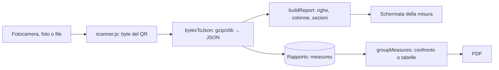

# Il QR del Testo e le misure

Come una misura dell'analizzatore di combustione **Testo 330** arriva nel rapporto: lettura del QR, decodifica, tabella di valori, confronto tra due misure.

## Cosa contiene il QR

Il QR del Testo non contiene testo: contiene **un JSON in formato [Testo TJF](https://github.com/testo/tjf) compresso con gzip**, in byte. Le app di scansione normali lo rovinano (lo trattano come testo), per questo Fiamma legge i **byte grezzi** con [zxing-wasm](https://github.com/Sec-ant/zxing-wasm) (in `vendor/`).



Quello che si **salva** nel rapporto è il JSON TJF originale (`measures[].json`): la tabella si ricostruisce ogni volta con `buildReport`. Così un miglioramento delle etichette vale anche per le misure già salvate.

## Lettura (`src/qr/scanner.js`)

- `startCamera({ video, onStatus, onBytes })`: apre la fotocamera posteriore (1920×1080 ideali), mette a fuoco in continuo se il telefono lo permette, e ogni 80 ms analizza il **quadrato centrale** del fotogramma (dove c'è il riquadro). Alla prima lettura valida si ferma da sola e chiama `onBytes(byte, testo)`. Restituisce `{ stop, hasTorch, setTorch(on) }`.
- `readImage(file)`: lettura da una foto, con più tentativi (rotazione, colori invertiti, riduzione) e fino a 8 simboli: serve se il QR è molto denso o c'è un riflesso sul display.
- **QR in più parti** (structured append): si raccolgono le parti, e finché ne mancano si scrive "Parte 1 di 3 letta: inquadra le altre". Le parti si uniscono nell'ordine dell'indice.
- Il file `.wasm` si carica dalla cartella `vendor/` (`locateFile`), così funziona offline.
- Errori leggibili (`cameraError`): permesso negato, nessuna fotocamera, fotocamera usata da un'altra app.

La schermata `src/screens/scan.js` ha tre ingressi: fotocamera, **"Da foto"** (`readImage`) e **"Importa file"** (`.gz`, `.json`, `.tjf`: si legge il file come byte). Due modi:

| Modo | Parametri | Cosa fa alla lettura |
|---|---|---|
| `quick` | — | Salva nelle scansioni rapide (`addScan`) e mostra la misura. |
| `attach` | `reportId` | Aggiunge la misura al rapporto (`addMeasure` + `saveReport`). Se nel rapporto c'è già una misura con lo stesso `uuid`, non la duplica: avvisa e apre quella. |

Un QR che non è del Testo (non decomprime o non è JSON) dà "Il QR letto non contiene dati Testo validi" e la lettura riprende dopo un secondo e mezzo. Quando l'app va in secondo piano la fotocamera si spegne e si torna alla schermata precedente. La schermata della misura tiene lo schermo acceso (`keepAwake`) mentre si ricopiano i valori.

## Decodifica (`src/qr/tjf/`)

`bytesToJson(byte)`:
1. se i byte cominciano con `1f 8b` → gzip; se sono un'intestazione zlib (`0x78…`) → deflate; altrimenti testo;
2. si decodifica in UTF-8 (senza BOM) e si fa `JSON.parse`. Si usa `DecompressionStream` del browser.

`buildReport(json)` restituisce un oggetto "report" generico, senza legami con un tipo di prova:

```js
{
  title,      // type.name, es. "Media (UNI 10389-1)"
  typeId,     // type.id
  start, end, // Date: inizio e fine della misura (o il timeStamp del file)
  header,     // [{ label, value }]: Combustibile, O₂ rif., CO₂ max
  note,       // nota scritta sullo strumento
  columns,    // ["Media"], o ["Media","Min","Max"], o [""] se c'è un solo valore per canale
  rows,       // [{ key, id, label, short, unit, cells: { colonna: "62,8" }, order }]
  sections,   // [{ title, items: [{ key, label, value }] }]
  errors,     // messaggi di errore dello strumento
  uuid        // identificativo della misura (per non duplicarla)
}
```

### Righe e colonne (`channels.js`)

- Ogni **canale** del JSON diventa una riga. Il canale si riconosce confrontando `measType`, `type.name` e `type.xmlid` con le espressioni di `CHANNELS` (`src/qr/tjf/labels.js`). Un canale riconosciuto ha un'etichetta in italiano (Temperatura fumi, Ossigeno…), una sigla (TF, O₂, CO…), i decimali e una posizione: **l'ordine dell'array `CHANNELS` è l'ordine con cui i valori appaiono**. I canali non riconosciuti si mostrano lo stesso, in fondo, con il nome che hanno.
- Le **colonne** vengono dai nomi delle statistiche in `values[].description` (`TotalMean` → *Media*, `TotalMinimum` → *Min*, `TotalMaximum` → *Max*, `Current` → *Attuale*, vedi `STAT_LABELS`); "Media" va sempre per prima. Se non ci sono statistiche si prende l'ultima lettura in una sola colonna senza nome.
- **Unità**: si usa `displayUnit` se si sa convertire (pressioni tra Pa, hPa, mbar, kPa, bar, psi…; temperature °C, °F, K), altrimenti l'unità del canale.
- **Valori**: `----` per un valore non valido (`4294967295`, stato di overrange…); se non c'è conversione e lo strumento ha già scritto il numero formattato (`"23,7"`) si usa quello; altrimenti il numero si formatta con la virgola, con i decimali dell'esponente, della definizione o dell'unità. Mai `-0,0`.

### Sezioni (`items.js` e `index.js`)

Le informazioni che non sono valori diventano sezioni richiudibili, nell'ordine: **Fasi della prova**, **Risultati**, appendici (Indice di fumo, Portata gas, Portata olio), **Dati prova**, **Punto di misura**, **Cliente**, **Azienda**, **Strumento** (o **Strumento 1**, **2**…), **Altri dati** (chiavi non conosciute, mostrate in modo generico). Il JSON completo si vede in "Dati grezzi (JSON)".

Le **fasi** (`phaseItems`) hanno `value` (`"19:10:24 → 19:11:24  (1 min 00 s)"`), ma anche `range` e `duration` separati: il PDF usa questi ultimi senza spezzare stringhe.

## Dalla misura al confronto (`src/model/measures.js`)

- `addMeasure(doc, json, { label })` aggiunge `{ id, label, json, addedAt }`. Senza etichetta si usano `nextMeasureLabel`: **Prima**, poi **Dopo**, poi **Misura 3**, **Misura 4**…
- `groupMeasures(measures)` decide come mostrarle (nell'ordine di prima comparsa):
  - misure dello **stesso tipo** (`type.id`, altrimenti `type.name`), tutte con **una sola colonna** di valori e almeno una riga → un blocco `compare`: una tabella con **una colonna per misura**, intestata con le etichette (Prima | Dopo). Le righe sono i canali: stesso canale e stessa unità sulla stessa riga (se un canale compare più volte nella stessa misura si distinguono per ordine);
  - le altre (Media/Min/Max, tipi diversi, una misura sola) → un blocco `single` ciascuna.
- Il blocco `compare` si usa nel PDF ([PDF](05-pdf.md)).

## Aggiungere o correggere un canale

1. Trova come si chiama nel JSON: guarda "Dati grezzi (JSON)" nella schermata della misura (`additionalData.measType`, `type.name`, `type.xmlid`).
2. In `src/qr/tjf/labels.js` aggiungi (o correggi) un elemento di `CHANNELS` con `id`, `label`, `short`, `dec` e l'espressione `re`; la **posizione** nell'array è la posizione nella tabella. Per un'etichetta di proprietà o di strumento, le altre tabelle (`PROP_LABELS`, `DEVICE_LABELS`…).
3. Prova con un campione in `tests/e2e/fixtures/*.json.gz` e `tests/unit/tjf.test.mjs`: quest'ultimo legge i campioni reali e controlla righe, colonne, fasi e formattazione.
