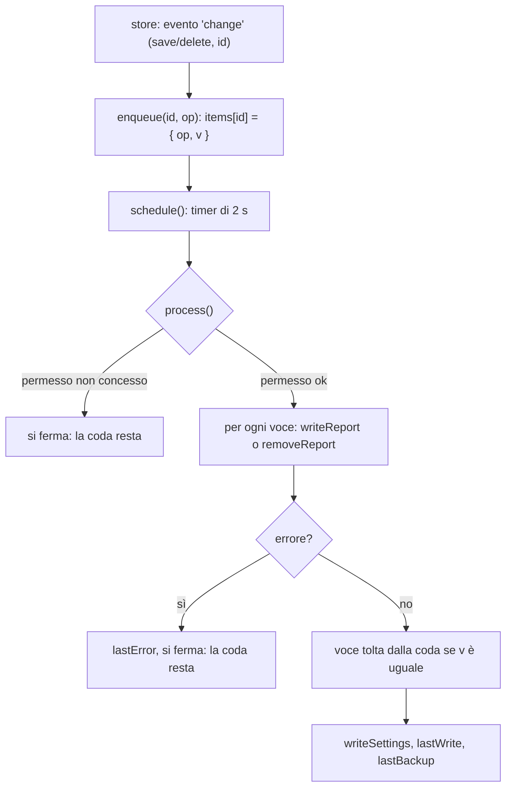

# Archiviazione e copie di sicurezza

Dove stanno i dati, come si salvano e come si copiano fuori dal telefono. Per la forma degli oggetti vedi [Modello dati](03-modello-dati.md).

## IndexedDB (`src/data/db.js`)

Un piccolo strato su IndexedDB con quattro operazioni per store: `getAll`, `get`, `put`, `remove`; più `getByIndex`, `removeByIndex` (solo `photos` per `reportId`) e `clear`. Le scritture aspettano la **fine della transazione** (`tx.oncomplete`), non solo la richiesta: quando `put` risolve, il dato è sul disco.

- **Se IndexedDB non è disponibile** (per esempio in una finestra privata) o non si apre, `db.js` passa a una memoria temporanea (`Map` per store): l'app resta usabile ma i dati durano finché la pagina è aperta. `usingMemory()` lo segnala e la home mostra un avviso rosso ("L'archivio del telefono non è disponibile…").
- `store.js` chiede al telefono di non cancellare i dati (`navigator.storage.persist()`) la prima volta che si crea un rapporto.

## `store.js`: l'archivio dei rapporti

Tutte le funzioni che toccano i rapporti passano di qui. `saveReport(doc, { edit })` applica `applyEdit` (aggiorna `updatedAt`, riporta "inviato" a "completato") a meno di `edit: false`, poi `put`. Dopo **ogni** scrittura emette un evento:

```js
store.events.addEventListener('change', (e) => { e.detail = { type: 'save' | 'delete', id } });
```

Chi vuole reagire (oggi `src/backup/folder/index.js`) ascolta l'evento: nessun modulo deve ricordarsi di avvisare la copia.

| Funzione | Note |
|---|---|
| `createReport()` | Bozza vuota, salvata subito. |
| `saveReport(doc, { edit })` | `edit: false` per i cambi di stato (chiusura, invio). |
| `loadAll()` | `{ reports, trash }` con **una** lettura; `listReports` e `listTrash` ne derivano. Gli elenchi sono ordinati: rapporti per data dell'intervento (poi ultima modifica), cestino dal più recente. |
| `trashReport`, `restoreReport` | Impostano o tolgono `deletedAt` (e aggiornano `updatedAt`, così il cambio vince su una copia più vecchia in un ripristino). |
| `purgeReport(id)` | Toglie rapporto e foto; emette `delete`. |
| `purgeExpired()` | Toglie dal cestino ciò che ci sta da più di 30 giorni. |
| `duplicate(doc)` | Nuova bozza con cliente e impianto. |
| `close(doc)` | Assegna il numero e aggiorna i contatori nelle impostazioni, poi salva con `edit: false`. |
| `markSent(doc)` | Passa a "inviato" e salva con `edit: false`. |
| `importReport(doc)` | Per i ripristini: scrive solo se manca o se `doc.updatedAt` è maggiore. |

## Foto e logo (`src/data/photos.js`)

- `compressImage(file, { maxSide, quality })`: decodifica rispettando la rotazione della fotocamera (`createImageBitmap(..., { imageOrientation: 'from-image' })`, con un'`Image` come ripiego), disegna su un canvas con sfondo bianco (i PNG trasparenti) e produce un JPEG. **Foto**: lato lungo 1280 px, qualità 0,8. **Logo**: 480 px, qualità 0,9.
- `addPhoto(reportId, file)` salva `{ id, reportId, blob, width, height, addedAt }`. L'editor ne ammette al massimo 20 per rapporto (`MAX_PHOTOS`).
- `photosForPdf(reportId)` e `logoForPdf()` danno i byte per [il PDF](05-pdf.md).
- `importPhoto` / `importLogo` sono per i ripristini: controllano identificativi, dimensioni (≤ 20000 px) e che sia un `Blob`, e non sovrascrivono una foto già presente.

## Scansioni rapide (`src/data/quickscans.js`)

Ultime 20 letture in `localStorage` (`testoqr.scans`): `{ id, savedAt, json }`. L'`id` è l'`uuid` della misura oppure un hash FNV-1a del JSON; rileggere lo stesso QR porta la voce in cima senza duplicarla. Non hanno dati del cliente né foto.

## La cartella di salvataggio (`src/backup/folder/`)

Una copia **a senso unico** (telefono → cartella) di rapporti, foto e PDF, che l'utente può sincronizzare con Drive, Syncthing o altro. Usa la **File System Access API** (`showDirectoryPicker`): risulta disponibile in Chrome per Android dalla versione 132. Il codice lavora su qualunque `FileSystemDirectoryHandle`: nelle prove nel browser si usa la cartella privata del browser (OPFS) al posto di quella scelta.

```
<cartella scelta>/Fiamma/
    impostazioni.json   logo.jpg
    rapporti/2026/2026-012_Mario-Rossi_ab12cd34/    (bozza: BOZZA_2026-10-22_Mario-Rossi_ab12cd34)
        rapporto.json   rapporto.pdf (solo se chiuso)   foto/01.jpg …
```

### Cosa si ricorda sul telefono (store `meta`)

| Chiave | Contenuto |
|---|---|
| `folder` | `{ key, handle, name, linkedAt, lastWrite }`: la cartella collegata (l'handle si conserva in IndexedDB) |
| `folderQueue` | `{ key, items: { [id]: { op: 'save' \| 'delete', v } } }`: le modifiche ancora da copiare |
| `folderIndex` | `{ key, reports: { [id]: { year, dir, photos } }, logo }`: cosa è già scritto, per sapere cosa rifare |

### La coda



- **Una scrittura alla volta**: `process()` non si sovrappone (`running`); se arrivano altre modifiche mentre scrive, ripete (`again`).
- Ogni voce ha una versione `v`: se il rapporto cambia di nuovo **mentre** si scrive, la voce non si toglie e verrà riscritta.
- La coda sta in IndexedDB: si perde solo se si cancellano i dati del sito. Chiudere l'app non perde nulla: alla riapertura (`start()`) si riprova.
- Il telefono può chiedere **di nuovo il permesso a ogni apertura**: lo stato è `permission !== 'granted'`, le modifiche restano in coda, la home lo ricorda e il tasto "Riattiva la cartella" (`reactivate`, serve un tocco: `requestPermission`) le fa partire.
- Quando l'app torna in primo piano (`visibilitychange`) si riprova, se l'ultimo tentativo non è fallito.
- Un rapporto **eliminato o nel cestino** si toglie dalla cartella; se lo si ripristina torna.

### Un rapporto nella cartella (`writer.js`)

`writeReport(link, id)`:

1. Se il rapporto non c'è più o è nel cestino → `removeReport`.
2. Calcola `folderPath(doc)` (`anno`, `cartella`). Se è cambiato rispetto all'indice (la bozza prende il numero alla chiusura, o cambia il nome del cliente) **toglie la cartella vecchia**; toglie anche ogni altra cartella con lo stesso `id8` (le prime 8 lettere dell'`id`).
3. Foto: riscrive `foto/` solo se l'elenco delle foto è cambiato (la "firma" è l'elenco degli id) o se la cartella è nuova.
4. Scrive **sempre** `rapporto.json`, e aggiorna l'indice.
5. Se il rapporto non è una bozza, genera e scrive anche `rapporto.pdf`.

`removeReport` usa l'indice; se non c'è traccia (dopo un ripristino) cerca per `id8` in tutti gli anni.

### Le impostazioni nella cartella (`settings-file.js`)

- `writeSettings`: **fonde** con l'`impostazioni.json` già presente (le impostazioni locali vincono sui campi non vuoti; per ogni anno vale il contatore più alto; il logo già in cartella non si perde se qui manca). Così collegare la cartella su un telefono nuovo **prima** del ripristino non sovrascrive le impostazioni salvate con quelle vuote. `lastBackup` non si scrive (è di quel telefono). Il logo si riscrive solo se la dimensione del file è cambiata.
- `peekSettings(handle)`: legge senza modificare niente. Quando l'utente sceglie la cartella e dentro ci sono già delle impostazioni, la schermata chiede se **caricarle al posto di quelle del telefono** (`takeSettingsFrom`): ditta, email, logo e numerazione; i contatori prendono il più alto, `lastBackup` resta quello del telefono. Rispondendo di no non si cambia nulla e il file nella cartella non viene toccato.

### Collegare, riattivare, ripristinare

| Funzione | Cosa fa |
|---|---|
| `pick()` | Apre il selettore di Chrome (`id: 'testoqr'`, `mode: 'readwrite'`); `null` se si annulla. |
| `linkHandle(handle, { fromFolder })` | (Opzionale: prende le impostazioni dalla cartella.) Salva il collegamento, azzera l'indice, accoda **tutti** i rapporti (`syncAll`). |
| `syncAll()` | Accoda tutti i rapporti e le impostazioni e parte (anche "Sincronizza ora"). |
| `reactivate()` | Controlla/chiede il permesso; se concesso, scrive la coda. |
| `unlink()` | Dimentica la cartella, la coda e l'indice (i file già copiati restano). |
| `test()` | Scrive e rilegge `prova.txt`: dice subito se la cartella funziona su questo telefono. |
| `restore()` | Rilegge `rapporto.json` e foto e li **unisce** a quelli del telefono (vince la modifica più recente), più impostazioni e logo. Durante il ripristino un flag (`restoring`) impedisce che i rapporti letti vengano riscritti nella cartella. Restituisce `{ reports, photos, skipped }`. |
| `status()` | `{ supported, linked, name, permission, pending, lastWrite, error }` per le schermate. |
| `events` | `EventTarget` che emette `state` quando cambia qualcosa (per aggiornare la schermata). |
| `explain(errore)` | Messaggio leggibile per gli errori più comuni (permesso, memoria piena, cartella sparita, file bloccato). |

### Particolarità importanti

- **`memoryCopy`**: un `File` letto dalla cartella (`getFile()`) dipende dal file che sta nella cartella; se poi quel file viene riscritto, il `File` diventa illeggibile (0 byte). Quello che si tiene sul telefono (foto, logo) si copia quindi **in memoria** prima di salvarlo. C'è una prova che fallisce senza questa copia (`tests/e2e/folder.cjs`).
- **Android**: non si può scegliere la radice della memoria né la cartella Download; va scelta una sottocartella (per esempio Documenti/Fiamma). Chrome scrive i file con un file temporaneo `.crswap`: le app di sincronizzazione vanno impostate per ignorarlo.
- **Non verificato su un telefono reale**: le prove nel browser usano una cartella privata. "Prova cartella" è lo strumento per controllare sul campo.
- `folder.testing.permission`: un gancio per le prove che simula il permesso scaduto (`'prompt'`) o negato, perché una cartella privata del browser non ha `queryPermission`.

## Backup in un file ZIP (`src/backup/zip-backup.js`, `src/lib/zip.js`)

Funziona su qualunque browser, anche dove la cartella di salvataggio non c'è. `createBackup({ withPhotos })` raccoglie tutto in un ZIP (formato in [Modello dati](03-modello-dati.md#formati-dei-file)), aggiorna `lastBackup` e restituisce `{ blob, name, reports, photos }`; `restoreBackup(file)` lo **unisce** ai dati del telefono con le regole di fusione sopra.

Lo ZIP lo scrive e lo legge `src/lib/zip.js`, **senza librerie**: voci con compressione `deflate-raw` fatta dal browser (`CompressionStream`), tranne le immagini (già JPEG, memorizzate senza compressione); nomi in UTF-8; CRC32 controllato in lettura; nessuna cifratura né ZIP64 (se il backup è troppo grande per un ZIP semplice lancia un errore leggibile). In lettura rifiuta voci oltre 256 MB, file danneggiati e metodi di compressione sconosciuti.

## Il promemoria

La home (`src/screens/home.js`, `renderReminder`) mostra una riga discreta quando serve: archivio non disponibile (rosso); cartella sospesa con modifiche in coda; copia nella cartella non riuscita (con il motivo); oppure, se non c'è una cartella collegata, **nessuna copia di sicurezza da più di 30 giorni** (`lastBackup`). Le righe di copia compaiono solo se ci sono rapporti; l'avviso rosso dell'archivio compare sempre.
