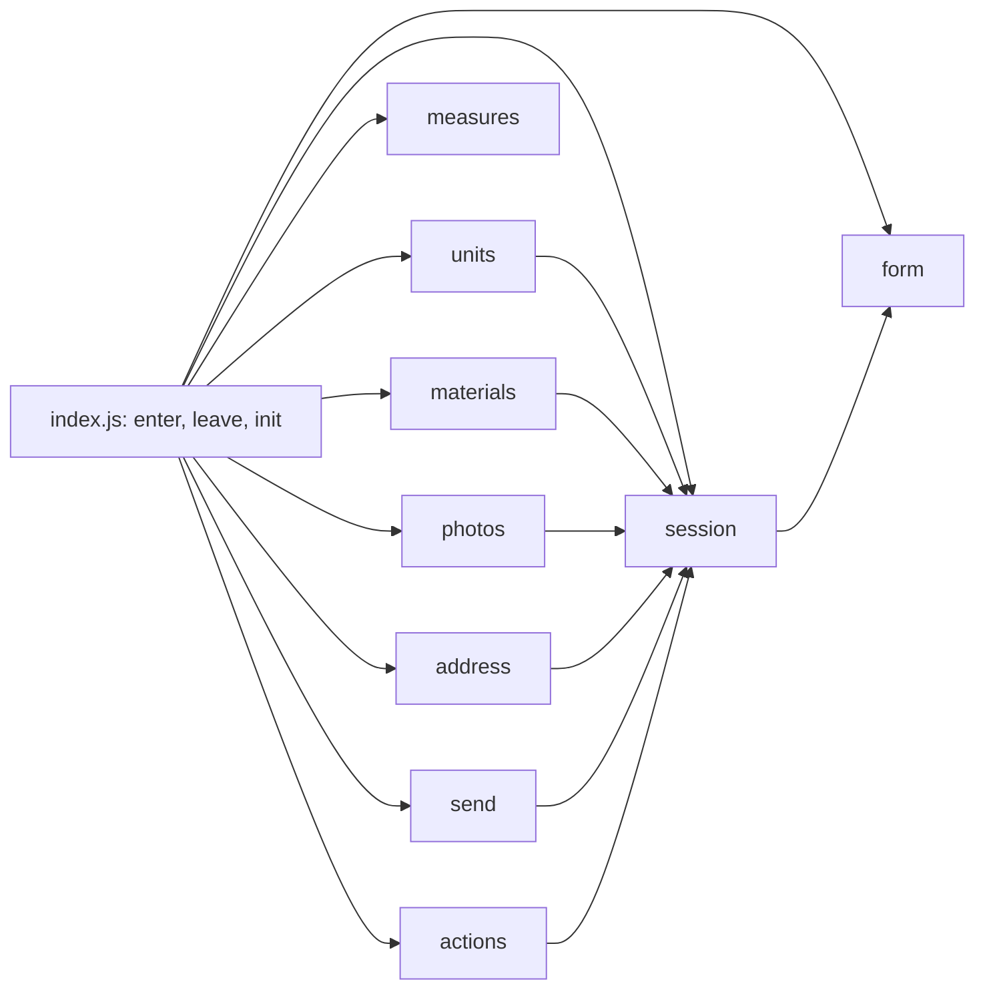

# Interfaccia

Come è fatta la pagina, come si applica lo stile e come funzionano la navigazione e l'editor. Il codice è in `index.html`, `css/`, `src/ui/` e `src/screens/`.

## Una pagina, tante schermate

`index.html` contiene **tutte le schermate**, una dopo l'altra: sono sette elementi `<main>` o `<section>` con id `view-<nome>` (`home`, `scan`, `measure`, `quick`, `editor`, `trash`, `settings`), più la foto a schermo intero (`photo-view`) e l'avviso a comparsa (`toast`). Una sola è visibile per volta; le altre hanno l'attributo `hidden`.

Gli **id** degli elementi seguono un prefisso per schermata, che il JavaScript e le prove usano:

| Prefisso | Dove |
|---|---|
| `h-`, `home-`, `report-list` | elenco dei rapporti |
| `e-`, `c-`, `u<n>-` | editor: `e-` generale (intervento, orari, salvataggio), `c-` cliente e note, `u0-brand`… i campi dell'apparecchio n-esimo |
| `m-`, `r-` | misura: etichetta (`m-`) e risultato (`r-`) |
| `q-`, `history` | scansioni rapide |
| `scan-`, `video`, `in-` | fotocamera e selettori di file |
| `t-`, `trash-` | cestino |
| `s-` | impostazioni (`s-co-…` la ditta, `s-folder-…`, `s-backup-…`) |
| `btn-` | pulsanti principali |

## Navigazione (`src/ui/nav.js`)

Ogni schermata si **registra** con il suo elemento e le sue funzioni:

```js
nav.register('editor', { el: 'view-editor', enter: editor.enter, leave: editor.leave });
```

- `go(nome, params)`: va a una schermata nuova (`history.pushState`); il tasto indietro di Android torna a quella di prima.
- `replace(nome, params)`: sostituisce la schermata attuale (per esempio dalla scansione alla misura letta, così "indietro" non torna alla fotocamera).
- `back()`: `history.back()`. `home()`: torna all'elenco qualunque sia la profondità.
- Lo stato nella history è `{ view, params, depth }`: ricaricando la pagina o con il tasto indietro si ricostruisce la schermata con gli stessi parametri.

`render(nome, params)` fa, in ordine: `leave()` della schermata che si lascia (che può salvare), nasconde le altre, **`await enter(params)`** della nuova e **solo dopo** la mostra: la schermata compare con i dati già pronti, senza un lampo di modulo vuoto. Se nel frattempo si è passati a un'altra schermata, quella in arrivo non viene mostrata.

Una schermata è un modulo che esporta `init()` (una volta, collega i pulsanti), `enter(params)` e, se serve, `leave()`.

## Stile: Tailwind CSS 4 "browser"

Non c'è un passo di build: si usa il build "browser" di [Tailwind CSS 4](https://tailwindcss.com) (`vendor/tailwindcss-browser.js`), che legge le classi presenti nella pagina e genera lo stile **nel browser**, a ogni apertura (circa 25 KB di CSS: sul telefono qualche decimo di secondo).

- `css/tailwind.css` ha il **tema** (`@theme`: font, colori) e i **componenti** ricorrenti (`@layer components`): `btn`, `btn-primary`, `btn-outline`, `card`, `input`, `icon`, `fld`, `lbl`, `sect`, `chip`. Il resto sono classi utility scritte direttamente nell'HTML.
- Il build "browser" legge solo blocchi `<style type="text/tailwindcss">`, non file esterni. Per questo `css/load-tailwind.js` carica `css/tailwind.css`, ne fa un blocco `<style>` e **solo dopo** avvia Tailwind (così la prima compilazione ha già tema e componenti). Intanto la pagina resta nascosta (`<html hidden>`) e si mostra quando lo sfondo di Tailwind è applicato; dopo 3 secondi si mostra comunque.
- L'interfaccia è **compatta e "da strumento"**: tema scuro, etichette piccole in maiuscolo, titoli di sezione con una linea che prosegue, numeri, date e codici in carattere a larghezza fissa (`font-mono`), valori misurati in carattere normale a cifre tabulari.

### Le classi create dal JavaScript

Tailwind genera lo stile solo per le classi che vede nella pagina; gli elementi creati dopo dal JS (righe di elenco, avvisi, foto…) hanno classi che nella pagina non ci sono ancora. Per questo tutte le classi usate dal JS stanno **in un posto solo**, `src/ui/classes.js`, e `registerClasses()` le mette all'avvio in un elemento nascosto: così lo stile è già pronto quando servono.

| Esportazione | Cosa contiene |
|---|---|
| `MSG`, `MSG_TYPES` | Forma e colori dei messaggi in riquadro (`success`, `error`, `warn`, `info`). |
| `TOAST` | L'avviso a comparsa. |
| `BADGES` | Le etichette di stato: `draft`, `done`, `sent`. |
| `CLS` | Il resto, per gruppi: elenco (`reportOpen`, `reportNum`…), apparecchi (`unitCard`…), cestino, salvataggio, materiali, storico, tabella dei valori, sezioni, foto, campi (`field`, `select`…). |

**Regola**: una classe nuova usata da JavaScript va aggiunta a `classes.js`. Una classe scritta solo nell'HTML non ha bisogno di niente.

## Utilità (`src/ui/util.js`)

| Funzione | Uso |
|---|---|
| `$(id)`, `el(tag, classe, testo)` | Scorciatoie per cercare e creare elementi. |
| `fieldElement(def, id)` | Un campo con la sua etichetta da una definizione (`{ label, unit, options, date, decimal, rows, type, inputmode, capitalize, wide }`): serve per i campi degli apparecchi (definiti in `src/model/units.js`) e della ditta (impostazioni). |
| `showBoxMsg(id, testo, tipo)` | Un messaggio in un riquadro colorato (`''` lo nasconde). |
| `toast(testo, tipo)` | Avviso a comparsa (1,8 s; gli errori 4,5 s). |
| `statusBadge(stato)` | L'etichetta Bozza / Completato / Inviato. |
| `debounce(fn, ms)` | Con `flush` e `cancel`: serve ai salvataggi. |
| `downloadFile(file)`, `openMailto(url)` | Scaricano un file o aprono Gmail toccando un link invisibile. |
| `canShareFiles()` | Il telefono sa condividere un PDF? |
| `keepAwake()`, `releaseAwake()` | Schermo acceso mentre si guardano i valori da ricopiare. |
| `explainSaveError(e)` | "memoria piena: libera spazio…" per `QuotaExceededError`. |

## L'editor del rapporto (`src/screens/editor/`)

L'editor è la schermata più grande; si divide in parti che condividono **un rapporto aperto** (`session.doc`):



- **`form.js`** ha la tabella `FIELDS`: per ogni campo semplice della pagina, il suo id e il suo percorso nel rapporto (`'c-name'` → `customer.name`). `fillForm(doc)` riempie la pagina, `readForm(doc)` la rilegge. Un solo ascoltatore su `#view-editor` (eventi `input` e `change`) chiama `touch()` quando cambia uno dei campi di `FIELDS`.
- **`session.js`** tiene `session.doc` e il salvataggio: `touch()` (da salvare), `flush()` (salva subito), `saveNow()`, `retrySave()`, `guarded(azione, { button })` (un errore si vede in un riquadro invece di sparire). L'esito sta sotto il titolo: "Salvato 14:32" / "Salvataggio…" / "NON SALVATO · tocca per riprovare".
- **Parti con liste** (`units.js`, `materials.js`, `measures.js`, `photos.js`) disegnano da sole la loro lista a partire da `session.doc` e dicono `touch()` quando cambia qualcosa.
- Chi usa `session.doc` in una funzione asincrona confronta il rapporto di partenza con quello corrente (`const current = session.doc; … if (current === session.doc)`): se nel frattempo si è aperto un altro rapporto, il risultato si scarta.
- Uscendo (`leave`): si tolgono le righe di materiale vuote, si salva (`flush`) e, se il salvataggio fallisce, un avviso dice che le ultime modifiche andranno perse.

### Gli apparecchi nell'editor

`units.js` disegna una scheda per apparecchio con `fieldElement` (campi presi da `UNIT_KINDS`), con id `u<indice>-<chiave>` (`u0-brand`, `u1-refrigerant`…) e un pulsante di eliminazione (`u<indice>-del`) che chiede conferma se la scheda è compilata. I tre pulsanti `e-add-caldaia`, `e-add-pompa`, `e-add-condizionatore` si collegano scorrendo `UNIT_KINDS`: per ogni tipo deve esistere nell'HTML un pulsante `e-add-<id del tipo>`, altrimenti `init()` dà errore (vedi [Guida allo sviluppo](10-guida-allo-sviluppo.md#un-nuovo-campo-o-un-nuovo-tipo-di-apparecchio)).

## Accessibilità e limiti noti

- I pulsanti con sola icona hanno `aria-label`; i filtri sono pulsanti con `aria-pressed`.
- Il viewport impedisce lo zoom a due dita (`user-scalable=no`): scelta "da app", ma toglie un aiuto a chi vede poco. Si può riattivare togliendo `maximum-scale` e `user-scalable` da `index.html`.
- Le conferme (`confirm`, `alert`) sono quelle di sistema: semplici e robuste, ma non personalizzabili.
