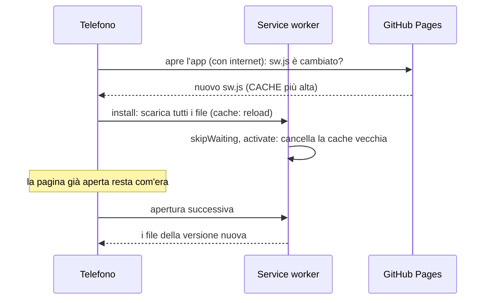

# Uso offline e pubblicazione

Come l'app funziona senza rete, come arrivano gli aggiornamenti sul telefono e come si pubblica.

## Il service worker (`sw.js`)

Un service worker **cache-first** salva tutti i file dell'app sul telefono: dopo la prima apertura con internet, l'app si apre e funziona anche senza rete (compresa la lettura del QR, il PDF e la copia nella cartella). Sta in radice perché il suo ambito (*scope*) è la cartella in cui si trova.

```js
const CACHE = 'fiamma-v30';       // la versione: si alza a ogni modifica
const FILES = [ './', './index.html', './manifest.json', './src/…', './css/…', './vendor/…', './img/…' ];
```

| Evento | Cosa fa |
|---|---|
| `install` | Scarica **tutti** i file di `FILES` nella cache `CACHE`, **dalla rete** (`new Request(file, { cache: 'reload' })`), poi `skipWaiting()`. |
| `activate` | Cancella le cache con un altro nome e prende il controllo delle pagine aperte (`clients.claim()`). |
| `fetch` | Per le richieste `GET` dello **stesso sito**: risponde dalla cache (`caches.match(…, { ignoreSearch: true })`), altrimenti va in rete. Le richieste ad altri siti (per esempio Nominatim) passano senza toccarle. |

Perché `cache: 'reload'`: GitHub Pages fa tenere i file al browser per una decina di minuti. Senza `reload`, `cache.add` potrebbe riprendere dalla cache HTTP i file della versione prima: la cache nuova si riempirebbe di file vecchi e il telefono resterebbe con una versione mista.

`ignoreSearch` serve alle scorciatoie dell'icona (`./?azione=nuovo`): l'indirizzo con il parametro trova comunque `index.html` nella cache.

### Come arriva un aggiornamento



Si vede la versione nuova **dalla seconda apertura** dopo la pubblicazione. Se l'aggiornamento non arriva, vedi [Problemi e risposte](../uso/08-problemi-e-risposte.md).

### Le due regole

1. **Dopo ogni modifica a un file in `FILES`, alza `CACHE`** (`fiamma-v30` → `fiamma-v31`). Senza, i telefoni che hanno già l'app non scaricano niente.
2. **Un file nuovo va aggiunto a `FILES`**; senza, quel file non è offline e l'app si rompe senza rete.

La seconda è controllata dalla prova `tests/unit/sw.test.mjs`: ogni file di `src/` e di `css/`, le icone del manifest, i file caricati da `index.html` e quelli di `vendor/` devono essere in `FILES`, e ogni file elencato deve esistere. Non controlla la versione: ricordarsi di alzarla è a carico di chi modifica. Le modifiche alla sola documentazione (`docs/`, `README.md`) e ai test non servono né l'una né l'altra: quei file non fanno parte dell'app.

`tests/e2e/offline.cjs` prova il risultato: carica l'app, aspetta che la cache sia piena, **spegne la rete** e controlla che l'app si riapra, che si possa creare un rapporto con una misura e una foto, chiuderlo e salvarne il PDF, e leggere un QR da una foto (il lettore e il file `.wasm` vengono dalla cache).

## Il manifest (`manifest.json`)

Rende l'app **installabile** ("Installa app" nel menu di Chrome): `short_name` "Fiamma", `display: standalone` (senza barra del browser), `orientation: portrait`, `start_url` e `scope` `./`, colori `#121212`, icone 192, 512 e una "maskable" 512 (l'icona adattiva di Android).

**Scorciatoie dell'icona** (tenendo premuta l'icona nella schermata Home): "Nuovo rapporto" (`./?azione=nuovo`) e "Scansione rapida" (`./?azione=scansione`). Le gestisce `runShortcut()` in `src/app.js`: legge il parametro `azione`, **ripulisce l'indirizzo** (`history.replaceState`, così un ricaricamento non la ripete) e crea il rapporto o apre la fotocamera. Chrome le aggiorna sull'app già installata anche dopo qualche giorno.

### Le icone

`img/icon.svg` è il disegno (un foglio con una fiamma e il mirino del QR). `node tools/make-icons.cjs` (serve Playwright) ricava i PNG con Chromium: `icon-512.png`, `icon-192.png`, `icon-maskable-512.png` e `apple-touch-icon.png` (180 px). Le due varianti "a tutta pagina" (maskable e Apple) hanno gli angoli vivi e il disegno ridotto per stare nella zona sicura.

## `index.html`: cosa c'è oltre alle schermate

- `lang="it"`, `color-scheme: dark`, `theme-color` e colore di sfondo `#121212`.
- `<meta name="referrer" content="no-referrer">`: l'app non manda l'indirizzo della pagina a nessuno. Solo la ricerca dell'indirizzo da posizione chiede l'origine (`referrerPolicy: 'origin'` su quella sola richiesta, come chiedono le regole d'uso di Nominatim).
- Meta `robots` che chiedono di non indicizzare né usare la pagina (`noindex`, `noai`…): è uno strumento di lavoro, non un sito pubblico.
- Gli script: `css/load-tailwind.js` nell'`<head>`; in fondo `vendor/zxing-reader.js` (carica zxing-wasm) e `src/app.js` come `type="module"`.

## Pubblicazione

Il sito è su **GitHub Pages** dal ramo `main`, cartella radice: <https://alezm00.github.io/fiamma-rapporti/>. Non c'è nessuna compilazione: un `git push` su `main` pubblica i file così come sono, in circa un minuto. Serve **https** (la fotocamera non funziona da http), e GitHub Pages lo fornisce.

Prima di pubblicare: prove verdi, `CACHE` alzata, file nuovi in `FILES` ([Guida allo sviluppo](10-guida-allo-sviluppo.md#prima-di-pubblicare)).

## Le librerie in `vendor/`

| File | Cosa è | Licenza |
|---|---|---|
| `tailwindcss-browser.js` | Tailwind CSS 4.3.3, build "browser" | MIT |
| `zxing-reader.js`, `zxing_reader.wasm` | zxing-wasm 3.1.5: lettore di QR | MIT |
| `pdf-lib.min.js` | pdf-lib 1.17.1 | MIT |
| `fontkit.umd.min.js` | @pdf-lib/fontkit 1.1.1 | MIT |
| `LiberationSans-Regular.ttf`, `…-Bold.ttf` | Font del PDF | SIL OFL 1.1 |

Ogni libreria ha il suo file di licenza accanto. Per **aggiornare** una libreria: sostituisci il file, prova (`tests/e2e/run.sh`), alza `CACHE`. Per Tailwind: prendi `dist/index.global.js` del pacchetto npm `@tailwindcss/browser`. Il file `.wasm` si carica da `vendor/` (`locateFile` in `src/qr/scanner.js`), quindi va aggiornato insieme a `zxing-reader.js`.
