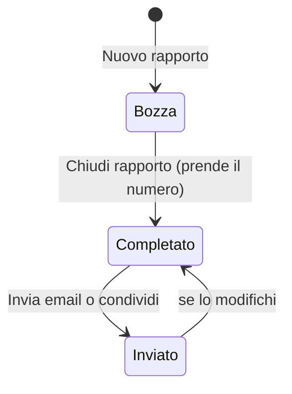

# I rapporti

Come si crea, si chiude, si invia, si recupera un rapporto, e come si trova nell'elenco.

## Il ciclo di vita

| Stato | Cosa vuol dire |
|---|---|
| **Bozza** | Lo stai scrivendo. Non ha numero: il PDF porta la scritta "BOZZA". |
| **Completato** | L'hai chiuso: ha il suo numero (per esempio `2026/012`). Puoi ancora modificarlo. |
| **Inviato** | L'hai mandato per email o l'hai condiviso. Se lo **modifichi** torna *Completato*, così in elenco si vede che quello che hai mandato non è più l'ultima versione e va rimandato. |

Una bozza non diventa mai *Inviato*: l'invio di una bozza la lascia bozza.

## Nuovo rapporto

**Nuovo rapporto** (nell'elenco, o dalla scorciatoia dell'icona) apre un rapporto **vuoto**, senza apparecchi. Si salva **da solo** a ogni modifica: sotto il titolo una scritta dice quando ("Salvato 14:32"). Se il salvataggio non riesce (per esempio la memoria è piena) compare **"NON SALVATO"** in rosso: tocca la scritta per riprovare. Uscendo da un rapporto non salvato un avviso dice cosa andrebbe perso.

Una bozza **mai compilata** (nessun dato, nessuna misura, nessuna foto) si scarta da sola quando torni all'elenco, per non lasciare righe vuote. Aggiungere un apparecchio, anche senza compilarlo, la rende "compilata".

## Chiudere il rapporto: il numero

**Chiudi rapporto** chiede conferma e dice il numero che prenderà: *"Chiudere il rapporto? Prenderà il numero 2026/012."* (se manca il nome del cliente lo ricorda).

- Il numero è **progressivo per anno**; l'anno è quello della **data dell'intervento**, non di quando chiudi.
- Si assegna **alla chiusura**, una sola volta: le bozze eliminate non lasciano buchi.
- Un rapporto eliminato **non libera** il suo numero.
- Per allinearti a un registro cartaceo puoi cambiare il prossimo numero dalle **Impostazioni** ([Numerazione](06-impostazioni.md#numerazione)).

Dopo la chiusura il rapporto resta modificabile.

## Duplicare

**Duplica** crea una nuova bozza con **cliente e impianto** (compresi gli apparecchi) del rapporto aperto, e la apre. Non copia misure, foto, lavori, materiali, orari né note, e la data è quella di oggi. Serve per i clienti che tornano.

## Eliminare e il cestino

**Elimina** sposta il rapporto nel **cestino**, da dove si recupera entro **30 giorni**; poi va via per sempre, **con le sue misure e foto**. Il numero già assegnato non viene riusato. Una bozza mai compilata si elimina subito, senza cestino.

Il cestino si apre dal link **"Cestino (N)"** in fondo all'elenco (compare solo se c'è qualcosa). Per ogni rapporto: **Ripristina** (torna com'era) o **Elimina per sempre**; e **Svuota il cestino** le toglie tutte. Ogni riga dice quanti giorni restano.

## L'elenco

Ogni riga mostra il **numero** (o "Senza numero"), lo **stato**, il **cliente** (o "Senza cliente"), l'indirizzo e una riga con data, tipo di intervento, numero di misure e di foto. Toccando una riga si apre il rapporto.

- **Ordine**: dal più recente per data dell'intervento (a pari data, l'ultimo modificato).
- **Raggruppati per mese**: ogni mese ha la sua intestazione con il numero di rapporti ("ottobre 2026 · 12").
- **Se sono molti**: se ne vedono **50 alla volta**; **Mostra altri** ne carica altri.

### Ricerca e filtri

- **Ricerca**: scrivi nel campo "Cerca cliente, targa, numero…". Trova per **numero, nome, indirizzo, telefono, targa e anche marca, modello e matricola di qualunque apparecchio**. Non conta maiuscole né accenti (*čok* trova *Cok*) e se scrivi più parole le trova **tutte** (anche in campi diversi: "udine roma").
- **Stato**: *Tutti*, *Bozze*, *Completati*, *Inviati*.
- **Anno**: se i rapporti coprono più di un anno compare una seconda fila di pulsanti, con *Tutti gli anni* e gli anni presenti.

I filtri si combinano. "Nessun rapporto trovato" vuol dire che nessun rapporto li soddisfa tutti.

## Il promemoria

In cima all'elenco può comparire una riga colorata:

- **Rossa**: "L'archivio del telefono non è disponibile…" ([Problemi](08-problemi-e-risposte.md#larchivio-del-telefono-non-è-disponibile)).
- **Arancione**: la copia nella cartella è sospesa (tocca per riattivarla) o non è riuscita.
- **Blu**: non c'è una copia di sicurezza recente (nessuna, o più vecchia di 30 giorni): collega una cartella o scarica un backup.

Toccandola si va alle Impostazioni, o si riattiva la cartella.
